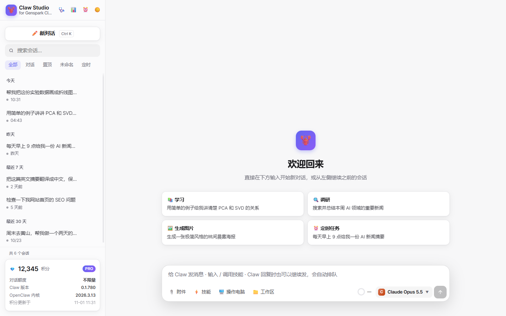
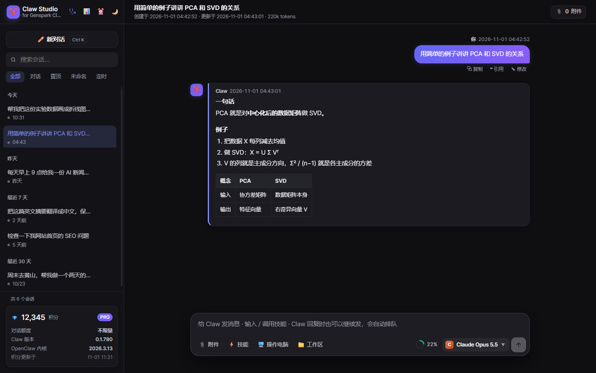
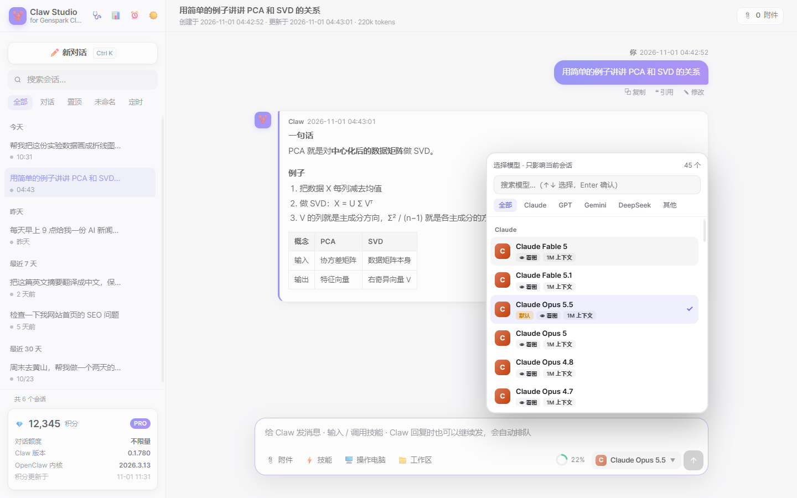
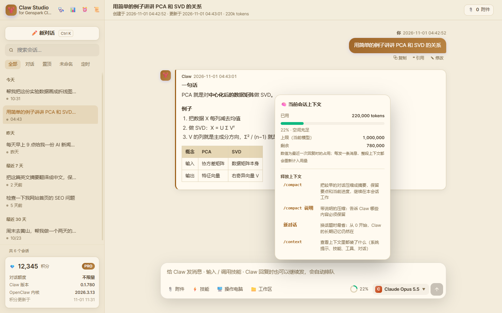

# 🦞 Claw Studio

**A better desktop front-end for [Genspark Claw](https://www.genspark.ai) on Windows.**
**Genspark Claw 的增强版桌面界面（Windows）。**

Claw Studio runs locally next to Genspark Claw and talks to the same OpenClaw gateway — same models, same skills, same memory, same chat history — with a much richer UI: rename/pin/search every conversation, image & file previews, message queue, context meter, daily token usage, and more.

Claw Studio 在本机与 Genspark Claw 共用同一个网关、同一套会话和记忆，不需要额外 API key，只是换了一个功能更多的界面。

> ⚠️ **Unofficial.** Not affiliated with Genspark. It relies on Genspark Claw / OpenClaw internals that may change between versions — use the built-in 🩺 self-test after upgrading.
> **非官方项目**，依赖 Claw 内部接口，升级后请用内置的 🩺 自检检查。



| Dark theme · 深色 | Model picker · 模型选择 | Context meter · 上下文占用 |
|---|---|---|
|  |  |  |

## Features · 功能

**Conversations · 会话**
- All conversations, grouped by date; **rename**, **pin**, search, filter (names stored locally, Claw untouched)
- Exact timestamps on every message; **copy / quote / edit** (editing while Claw is thinking stops it and resends)
- **Message queue** — keep typing while Claw works; queued messages are sent in order
- Claw replies in framed cards; high-contrast text selection

**Everything the official app does · 官方功能**
- `/` skill menu · per-conversation **model picker** · scheduled tasks (cron) · **computer-use** mode · local **workspace** folder
- Credit balance & version · **Claw update notification with one-click upgrade**

**Enhancements · 增强**
- **Up to 20 attachments** at once (paste / drag & drop)
- Images in history render as real pictures; **PDF / .ipynb / txt / md / code** preview in-app; open / reveal / download any file
- 📎 per-conversation attachment list
- **Context usage ring** with `/compact` suggestions · 📊 **daily token usage** (input / cache / output, per model)
- Light / dark / sepia themes · desktop icon + standalone window
- 🩺 **self-test** (17 checks) runs automatically when Claw / OpenClaw versions change

## Requirements · 环境

- Windows 10 / 11
- [Genspark Claw](https://www.genspark.ai) installed and signed in (opened at least once)
- Microsoft Edge or Google Chrome (for the app window)
- **No Node.js needed** — Claw Studio runs on the Electron runtime bundled with Genspark Claw.

## Install · 安装

```powershell
git clone https://github.com/Chenny93/claw-studio.git
cd claw-studio
powershell -ExecutionPolicy Bypass -File install.ps1
```

Or download the ZIP, extract it anywhere, right-click `install.ps1` → **Run with PowerShell**.
This creates a **Claw Studio** shortcut on the desktop and Start menu. Right-click it → *Pin to taskbar*.

双击桌面「Claw Studio」即可。若 Genspark Claw 没开，会自动在后台启动它（冷启动约 1–3 分钟）。

## Uninstall · 卸载

```powershell
powershell -ExecutionPolicy Bypass -File uninstall.ps1
```
Removes shortcuts and stops the service. Your Genspark Claw data and chat history are never touched.

## How it works · 原理

```
 Edge/Chrome --app window ──HTTP/SSE──▶ src/server.js (127.0.0.1:28900)
                                            │  reads  %APPDATA%\Genspark Claw\users\<id>\agents\main\sessions\*.jsonl
                                            └─ WebSocket ─▶ OpenClaw gateway (127.0.0.1:28815, token from openclaw.json)
                                                             chat.send · sessions.patch · skills.status · cron.* · config.get
```

- Everything is **local** and bound to `127.0.0.1`. No telemetry, no external calls by Claw Studio itself.
- Session history is **read-only**; rename/pin data, uploads and window settings live in `%LOCALAPPDATA%\ClawStudio`.
- **Window browser** follows your Windows default browser (Chrome → Chrome, otherwise Edge). Force one with `%LOCALAPPDATA%\ClawStudio\settings.json`: `{"browser": "chrome"}` or `"edge"`. The window uses its own isolated profile.
- **External links** clicked inside Claw Studio open in your **default browser**, not inside the app window.
- Paths are auto-detected. Override with environment variables if needed:
  `CLAW_STATE_DIR` (user data dir), `CLAW_EXE` (path to `Genspark Claw.exe`), `CLAW_STUDIO_PORT` (default 28900).

## Troubleshooting · 故障排查

| Symptom | Fix |
|---|---|
| "Genspark Claw didn't start within 5 minutes" | Open Genspark Claw manually once, then launch Claw Studio again |
| "Service failed to start" | See `%LOCALAPPDATA%\ClawStudio\server.err.log` |
| Something broke after a Claw update | Click 🩺 → *Full check*. Each failing item shows what changed and where to fix it |
| `gsk` returns 403 / Claw web search, image & video tools fail behind a proxy (VPN / Clash / etc.) | Node-based tools don't use the Windows system proxy. Add to `openclaw.json`: `env: { vars: { HTTPS_PROXY: 'http://127.0.0.1:<port>', HTTP_PROXY: 'http://127.0.0.1:<port>', NODE_USE_ENV_PROXY: '1', NO_PROXY: 'localhost,127.0.0.1' } }` then restart Claw. 🩺 detects this automatically |
| Launcher log | `%LOCALAPPDATA%\ClawStudio\launch.log` |

## Security note · 安全

The gateway token in `openclaw.json` grants full operator access to your local Claw. Claw Studio only uses it on `127.0.0.1` and never exposes the server to the network. **Do not** change it to listen on `0.0.0.0`.

## License

[MIT](LICENSE) © 2026 Chenny93. "Genspark" and "Genspark Claw" are trademarks of their respective owners.
